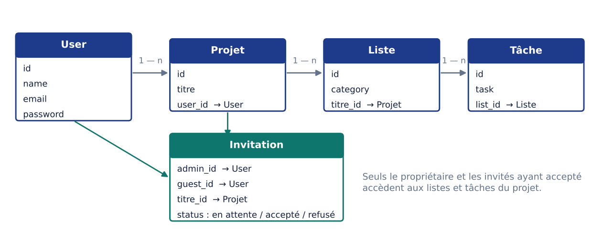

<p align="center"></p>

# TrelloLike : gestionnaire de projets en Kanban


Une application web inspirée de **Trello** pour organiser des projets en **listes et tâches**, et
**travailler à plusieurs** grâce à un système d'invitations.

## Fonctionnalités

| Domaine | Ce que l'on peut faire |
|---|---|
| **Comptes** | Inscription, connexion, mot de passe oublié (authentification Laravel UI) |
| **Projets** | Créer ses projets et les retrouver sur son tableau de bord |
| **Listes** | Ajouter, renommer et supprimer des colonnes (« À faire », « En cours », « Terminé »…) |
| **Tâches** | Ajouter et supprimer des tâches dans chaque liste |
| **Collaboration** | Inviter un utilisateur sur un projet par e-mail ; l'invité **accepte ou refuse** ; le propriétaire voit les réponses |
| **Contrôle d'accès** | Seuls le propriétaire et les invités ayant accepté accèdent aux listes d'un projet |

## Architecture

Application **MVC Laravel** classique : contrôleurs, modèles Eloquent et vues Blade.



| Couche | Contenu |
|---|---|
| `routes/web.php` | Routes protégées par le middleware `auth` |
| `app/Http/Controllers` | `ProjetController`, `ListController`, `TaskController`, `InvitationController`… |
| `app/Models` | `Projet`, `ListTrello`, `Task`, `Inviation`, `User` et leurs relations |
| `database/migrations` | Schéma des tables projets, listes, tâches et invitations |
| `resources/views` | Vues Blade : tableau de bord, vue Kanban d'un projet, invitations |

## Lancer le projet

Prérequis : PHP 8, Composer, MySQL (ou MariaDB), Node.js.

```bash
composer install
cp .env.example .env          # renseigner DB_DATABASE, DB_USERNAME, DB_PASSWORD
php artisan key:generate
php artisan migrate
npm install && npm run dev
php artisan serve             # http://localhost:8000
```

## Pistes d'amélioration

- Glisser-déposer des tâches entre les listes
- Ordre des tâches et dates d'échéance
- Clés étrangères avec suppression en cascade (liste vers tâches)
- Tests fonctionnels (PHPUnit) sur le contrôle d'accès

## Compétences mobilisées

PHP / Laravel · Architecture MVC · Eloquent ORM et relations · Authentification et middleware ·
Gestion des droits d'accès · Blade · Modélisation de base de données

---

**Hanene Triaa** · 2022
